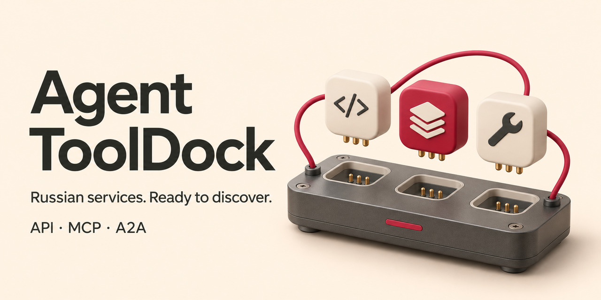

# Agent ToolDock

**An MCP server with a registry of Russian service APIs, MCP servers and A2A connections.**

Descriptions of **312 connections to 232 services** are collected in one place, based on public documentation: what each connection can do, how to get access, what its limitations are and where to find the original sources.

Connect ToolDock to your AI agent so it can find suitable services for a task and compare options. Access to the selected service is configured separately.

**214 APIs · 97 MCP entries · 1 A2A entry**

Search runs locally, with no API keys required. The registry is also available through a CLI, JSON and CSV.

[Русский](README.md) · [Usage guide](docs/USAGE.md) · [JSON dataset](data/catalog.json) · [CSV dataset](data/catalog.csv) · [Contribute a service](CONTRIBUTING.md)

## From a task to a suitable service

| Task | Example in the registry | What the record explains |
| --- | --- | --- |
| Prepare a grocery cart | VkusVill · MCP · `if-061` | Product search and a link to a prepared cart. The user completes the purchase in the service. |
| Control home devices | Yandex Smart Home · API · `if-303` | Device commands and existing scenarios. An OAuth application and permissions are required. |
| Build an automation | Albato · A2A · `if-240` | Creating and running automations. A manager provides the endpoint and partner token. |

These examples describe provider-documented capabilities. Set up the selected provider's connection and credentials separately to use them.

## Try it in a minute

Requires **Node.js 22+**. Extract the source files into a directory named `agent-tooldock`. Local search runs offline, with zero dependencies and no API keys.

```sh
cd agent-tooldock
npm test
npm run demo
```

The demo displays a real VkusVill search result. Try a query or inspect a full record next.

```sh
node src/cli.mjs search ВкусВилл --protocol MCP
node src/cli.mjs get if-061
node src/cli.mjs search --audience personal --stage order
```

The final command returns **8 connections** with documented order placement in personal-use scenarios in this snapshot. Audience and stage filters distinguish buyer access from seller tools, and cart preparation from order placement.

## Give your agent access to the registry

Add this server to an MCP client that supports local stdio servers. Replace the path with the absolute path to your own directory.

```json
{
  "mcpServers": {
    "agent-tooldock": {
      "command": "node",
      "args": ["/absolute/path/agent-tooldock/src/stdio.mjs"]
    }
  }
}
```

Then ask your agent to find suitable options.

> Find official connections to Russian services that support order placement for a personal AI assistant. Compare their capabilities, access requirements and limitations. Include the documentation links.

| MCP tool | Result |
| --- | --- |
| `find_connections` | Matching records with capabilities and access requirements |
| `get_connection` | A complete record and its primary sources by ID |
| `catalog_stats` | Protocols, categories and snapshot counts |

Search uses keywords and structured filters. Your agent interprets the task, chooses parameters and compares the returned records. **Most source descriptions are in Russian.** Use Russian service names or keywords in text queries, as in the example above. Structured filter values are in English.

## Inside the dataset

The **7 November 2026** snapshot was prepared by **Victoria Dochkina**. The underlying research examined public descriptions of 424 companies and products. The registry includes 232 services with documented connections.

Each record represents one service–protocol pair. Records separate information retrieval, preparation and actions, personal and business scenarios, connection provenance and access requirements. Relevant claims include links to primary sources.

Capabilities were assessed from documentation. Provider integrations and real operations were not tested during the research. Check current provider documentation before setting up a connection.

## Use it and contribute

Embed the JSON dataset in your agent project, explore the CSV or connect the MCP server to your workflow. To update a record or add a service, include a primary source and its access requirements. See the [contribution guide](CONTRIBUTING.md).

The [usage guide](docs/USAGE.md) covers configuration, filters, formats and methodology in Russian. Code is licensed under [MIT](LICENSE), and research descriptions under [CC BY 4.0](DATA-LICENSE.md).
