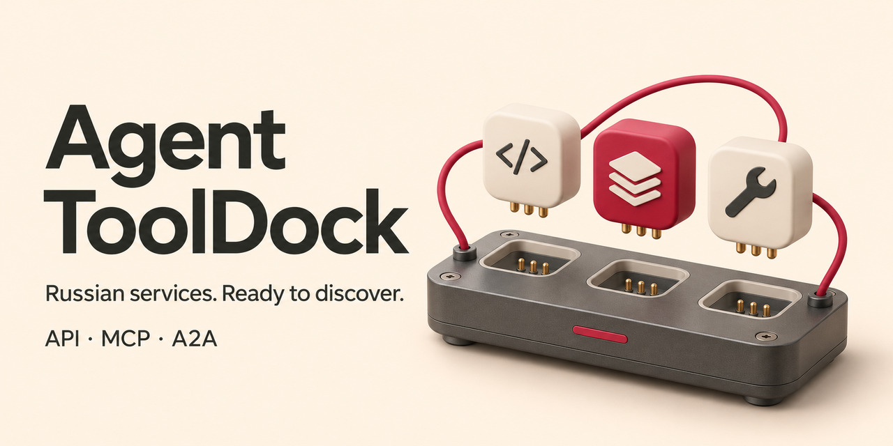

# Agent ToolDock

**MCP-сервер с реестром API, MCP и A2A российских сервисов.**

В одном месте собраны описания **312 подключений к 232 сервисам**, составленные по публичной документации: что умеет каждое подключение, как получить доступ, какие есть ограничения и где найти первоисточник.

Подключите ToolDock к своему ИИ-агенту — он сможет искать подходящие сервисы под задачу и сравнивать варианты. Доступ к выбранному сервису настраивается отдельно.

**214 API · 97 MCP · 1 A2A**

Поиск работает локально, без ключей API. Реестр также доступен через CLI, в JSON и CSV.

[English](README.en.md) · [Инструкция](docs/USAGE.md) · [Данные JSON](data/catalog.json) · [Данные CSV](data/catalog.csv) · [Добавить сервис](CONTRIBUTING.md)

## От задачи к подходящему сервису

| Задача | Пример из реестра | Что показывает карточка |
| --- | --- | --- |
| Подготовить корзину продуктов | ВкусВилл · MCP · `if-061` | Поиск товаров и создание ссылки на корзину. Покупку пользователь завершает в сервисе. |
| Управлять устройствами дома | Яндекс Умный дом · API · `if-303` | Команды устройствам и запуск существующих сценариев. Нужны OAuth-приложение и разрешения. |
| Собрать автоматизацию | Альбато · A2A · `if-240` | Создание и запуск автоматизаций. Адрес подключения и партнёрский токен выдаёт менеджер. |

Это примеры возможностей, описанных провайдерами. Для работы с выбранным сервисом вы отдельно настраиваете его подключение и доступы.

## Попробуйте за минуту

Нужен **Node.js 22+**. Распакуйте исходники в папку `agent-tooldock`. Локальный поиск работает офлайн, без зависимостей и ключей API.

```sh
cd agent-tooldock
npm test
npm run demo
```

Демо показывает реальную выдачу по ВкусВиллу. Затем попробуйте свой запрос или откройте полную запись.

```sh
node src/cli.mjs search ВкусВилл --protocol MCP
node src/cli.mjs get if-061
node src/cli.mjs search --audience personal --stage order
```

Последний запрос возвращает **8 подключений** с документированным оформлением заказа в личном сценарии в текущем срезе. Поиск и фильтры помогают отделить доступ покупателя от инструментов продавца, а подготовку корзины — от оформления заказа.

## Дайте поиск своему агенту

Добавьте сервер в MCP-клиент с поддержкой локального транспорта stdio. Замените путь на абсолютный путь к своей папке.

```json
{
  "mcpServers": {
    "agent-tooldock": {
      "command": "node",
      "args": ["/absolute/path/agent-tooldock/src/stdio.mjs"]
    }
  }
}
```

Теперь попросите агента подобрать варианты.

> Найди официальные подключения российских сервисов для моего личного агента, которые позволяют оформить заказ. Сравни возможности, условия доступа и ограничения. Покажи ссылки на документацию.

| Инструмент MCP | Результат |
| --- | --- |
| `find_connections` | Подходящие записи с функциями и условиями |
| `get_connection` | Полная карточка и первичные источники по ID |
| `catalog_stats` | Протоколы, направления и размер выборки |

Сам поиск использует ключевые слова и фильтры. Агент интерпретирует задачу, подбирает параметры и сопоставляет найденные записи. Описания в реестре преимущественно на русском языке.

## Что внутри данных

Срез на **7 ноября 2026 года** подготовила **Виктория Дочкина**. Изучены публичные описания 424 компаний и продуктов. В реестр вошли 232 сервиса с найденной документацией подключений.

Одна запись соответствует сочетанию «сервис × протокол». В карточке отдельно указаны чтение информации, подготовка и выполнение действий, личные и бизнес-сценарии, авторство подключения и условия получения доступа. Ключевые сведения сопровождаются ссылками на источники.

Возможности оценены по документации. Интеграции с провайдерами и реальные операции в ходе исследования не тестировались. Условия нужно сверять с актуальной документацией перед настройкой.

## Используйте и дополняйте

Встраивайте JSON в свой агентный проект, анализируйте CSV или подключайте MCP к рабочему процессу. Для исправления записи или добавления сервиса приложите первичный источник и условия доступа. [Как внести вклад](CONTRIBUTING.md).

Подробности о фильтрах, форматах, настройке и методологии собраны в [инструкции](docs/USAGE.md). Код распространяется по [MIT](LICENSE), исследовательские описания — по [CC BY 4.0](DATA-LICENSE.md).
